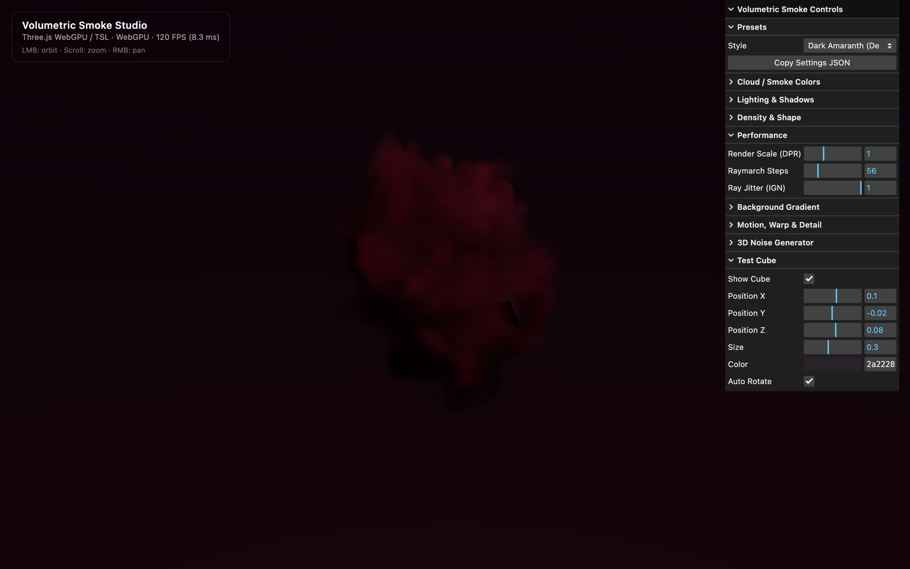

# Volumetric Smoke Studio

**[Live Demo →](https://kozakbartosz.github.io/volumetric-smoke-studio/)**

Real-time volumetric smoke & cloud raymarching built with **Three.js WebGPU / TSL** (with automatic WebGL2 fallback), **TypeScript**, and **Vite**.



## Features

- **Volumetric 3D Raymarching (TSL)** on a single cubic box with:
  - Packed RGBA 3D detail/warp texture (domain-warped swirling filaments + edge erosion in 1 texture fetch)
  - 3-tap exponentially spaced Beer-Lambert self-shadowing + free micro-relief shading
  - Interleaved Gradient Noise (IGN) ray jitter & empty-space skipping for high FPS
  - Depth-aware ray clipping (`viewportDepthTexture`) so volumetric smoke wraps cleanly around 3D meshes
  - Henyey-Greenstein forward-scattering rim glow, powder darkening, and optional inner core glow
- **Live Controls (`lil-gui`)**: presets, colors, lighting & shadows, density, performance (`Render Scale`, `Raymarch Steps`, `Ray Jitter`), background gradient, wind/warp motion, 3D FBM noise generator, and a depth-tested cube.

## Getting Started

```bash
npm install
npm run dev
```

## Scripts

- `npm run dev` — start Vite dev server
- `npm run typecheck` — run TypeScript type checking (`tsc --noEmit`)
- `npm run build` — typecheck and build for production
- `npm run preview` — preview production build
